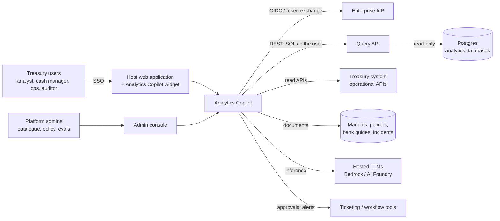
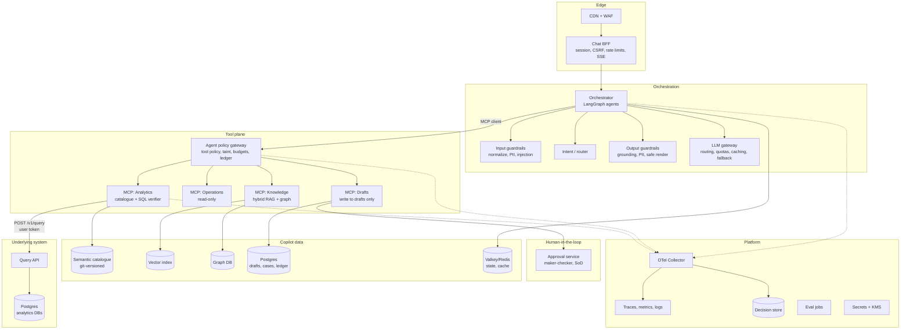
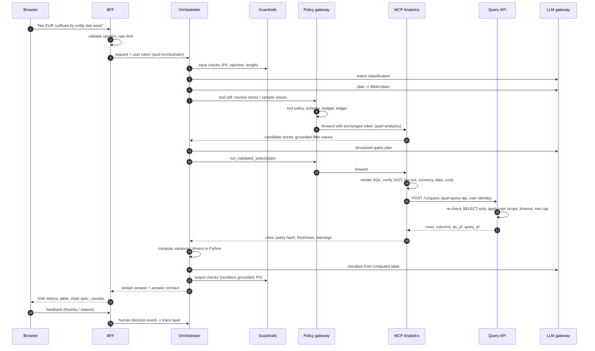
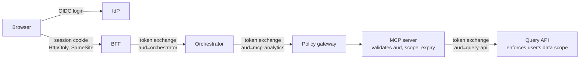

# Analytics Copilot — Architecture

Reference architecture for **Analytics Copilot**: an enterprise treasury assistant built into a web application as a global chatbot. The copilot reaches governed data and tools through MCP servers. This document covers the system shape, the request lifecycle, the security model and deployment.

**Deployment targets:** AWS is the primary cloud. Azure is second. Every service also runs on a laptop with Docker Compose. Product scope and per-capability design live in [FinAnalytics.md](FinAnalytics.md).

Decisions referenced as **D1–D11** are recorded in FinAnalytics.md §16. Items marked **[ADR]** become Architecture Decision Records under `docs/adr/`. **[VERIFY]** means check against current vendor docs and spec versions before building. **[CONFIRM]** means confirm with the owner of the underlying system.

---

## 1. Architectural principles

1. **Read and draft, never execute.** No tool can release payments, change configuration or finalize matches. The highest tool tier is `DRAFT`, and approval is a separate human service.
2. **Deterministic gates are final.** SQL verification, tool policy and money arithmetic run in code. A model can explain a block but cannot override one.
3. **The underlying system owns data authorization (D6).** The copilot never holds broader data rights than the user. Every query runs as the requesting user, and the underlying system decides what that user may see. The copilot adds its own controls on top (tool policy, verification, redaction), never instead.
4. **Fail closed.** If the gateway, authentication or a guardrail is unavailable, the request is refused, not degraded to an unguarded path. A copilot outage never affects the host application.
5. **Everything is traced and replayable.** One trace id links the prompt, retrievals, tool calls, policy decisions and the final human decision.
6. **Containers everywhere, managed services at the edges.** Every service is a container image that runs the same way on a laptop, on AWS and on Azure. Cloud-managed services plug in behind adapters.
7. **Evaluation is a release gate.** No prompt, model, catalogue or policy change ships without passing the eval suite.

---

## 2. System context



For the showcase, the Query API, analytics databases, operational APIs and documents are provided by a **synthetic treasury domain** (FinAnalytics.md §4). The copilot talks to them through the same interfaces a real deployment would use (§9).

---

## 3. Container view



### Component responsibilities

| Component | Responsibility |
|---|---|
| Chat BFF | Session handling, exchange of the SSO session for user tokens, CSRF, per-user rate limits, SSE streaming, response sanitization |
| Orchestrator | LangGraph graphs per capability, conversation state, run caps (iterations, tool calls, cost, wall clock), progress events |
| Intent / router | Layered classification (rules, small model, LLM fallback), confidence, clarification trigger |
| Input / output guardrails | PII detection and redaction, injection screening, grounding and number checks, output PII scan, render sanitization |
| LLM gateway | Provider abstraction (Bedrock, AI Foundry, direct API), model routing by role, quotas, prompt caching, retries, fallback, cost metering |
| Agent policy gateway | Per-agent tool allowlists, argument schemas, taint tracking, budgets, hash-chained tool ledger. It does **not** decide data scope (D6). |
| MCP: Analytics | Store discovery, business-term resolution, value grounding, SQL rendering and verification, calls to the Query API, freshness |
| Query API | REST service that executes read-only SQL on the Postgres analytics databases **as the user** (§8.2). Owned by the underlying system; a reference implementation ships with the showcase. |
| MCP: Operations | Read-only access to messages, transactions, statements, reconciliation, static data, permissions |
| MCP: Knowledge | Hybrid retrieval with document ACL filters, chunk fetch, parameterized graph templates, similar incidents |
| MCP: Drafts | Typed drafts with provenance; submit for review; cannot approve |
| Approval service | Maker-checker approval, SoD checks, step-up authentication, decision events |
| Eval jobs | Gold sets, DeepEval and programmatic suites, CI gates, scheduled online sampling |
| Async workers | Document ingestion, catalogue drift checks, synthetic-world generation, detectors, long agent workflows |

---

## 4. Request lifecycle: a data-insight question



**Latency budget** (p95, insight question, target under 60 s):

| Stage | Budget |
|---|---|
| Guardrails | < 300 ms |
| Intent | < 500 ms |
| Planning and resolution | 3–6 s |
| Query plan | 3–6 s |
| Verify | < 1 s |
| Execution | Bounded by the Query API timeout |
| Analysis | 3–5 s |

The UI streams a progress event at each stage.

---

## 5. Identity and security architecture

### 5.1 Identity flow



- **Users.** OIDC (or SAML bridged to OIDC) through the enterprise IdP. MFA is enforced by the IdP, with step-up for sensitive capabilities. The widget reuses the host application's SSO session.
- **Tokens.** Short-lived, audience-bound access tokens at every hop via OAuth 2.0 Token Exchange (RFC 8693). MCP servers act as OAuth resource servers per the MCP authorization specification. **Tokens are never passed through**: each hop gets a token for the next audience. **[VERIFY current MCP auth spec revision]**
- **Services.** AWS uses IAM roles for ECS tasks; Azure uses managed identities. TLS between services. No long-lived shared secrets.

### 5.2 Authorization split (D6)

| Concern | Owner | Mechanism |
|---|---|---|
| Who may see which rows, columns, entities, accounts | **Underlying system** | Query API executes as the user; scope enforced there, e.g. Postgres row-level security keyed on the user identity [CONFIRM] |
| Who may use which copilot capability | Copilot, from IdP or host-app roles | Role claims in the token, checked by the BFF and orchestrator |
| Which agent may call which tool with which arguments | Copilot policy gateway | Versioned YAML policy in the repository; no external policy engine needed |
| Who may approve a draft | Approval service | Approver groups per draft type; SoD check against entitlements read from the underlying system |
| Which documents a user may retrieve | Document source ACLs | ACL metadata copied at ingestion; filters applied inside the retrieval query |

**Consequences of delegating data authorization:**
- Result caches are keyed per user (query hash + snapshot + user id), because the copilot cannot know which users share a scope.
- Aggregates shown to a user come only from rows the Query API returned to that user, so the copilot cannot widen access.
- The copilot still applies small-cell suppression and redaction on output as defence in depth.
- **Fallback if the underlying system cannot enforce row scope for the Query API:** the Analytics server injects scope predicates from the Operations `get_permissions` endpoint and re-verifies the query. This is a documented degradation, not the default.
- An external policy engine (OPA or Cedar) is a later option if tool policy grows complex. It is not needed now.

**Tenancy (D8).** Pooled by default, with a tenant id in every token, key, index namespace, cache key, trace attribute and draft. A silo option (dedicated stack per tenant) is available for regulated tenants. Cross-tenant leakage tests run in CI.

### 5.3 Security controls by layer

| Layer | Controls |
|---|---|
| Edge | AWS WAF (managed rule groups) or Azure Front Door WAF, TLS 1.2+, CSP, strict CORS, per-user and per-tenant rate limits |
| App | CSRF tokens, output sanitization (no active HTML, no auto-loaded external images or links in chat render), input size limits |
| LLM | Prompt-injection screening, taint tracking, plan-then-execute, tool allowlists, no tools on extraction agents |
| Tool | JSON-schema validation, SQL AST verifier, row caps, cost guards |
| Query API | Re-parses SQL (single SELECT), read-only transaction and role, `statement_timeout`, row cap, schema allowlist, user-scoped execution |
| Data | Classification tags per column and document, redaction and tokenization, encryption at rest (KMS / Key Vault with customer-managed keys) and in transit |
| Supply chain | Pinned dependencies, SBOM (Syft), image scanning (Trivy or Amazon Inspector / Defender for Containers), signed images (cosign), SLSA provenance, internal MCP servers only with pinned, reviewed tool manifests |
| Runtime | Non-root containers, read-only root filesystem, security groups / NSGs default deny, private subnets, VPC endpoints / private endpoints for model and data services |
| Audit | Hash-chained tool ledger, decision store, immutable log archive (S3 Object Lock / Blob immutable storage) |
| Response | Kill switches per capability, tool, model and tenant; incident runbooks; key rotation |

Threat-modelling references: OWASP Top 10 for LLM Applications, MITRE ATLAS, and STRIDE for the non-LLM surface. **[VERIFY current versions]**

---

## 6. Compute model (D10)

### 6.1 Traffic profile and what follows from it

Analytics questions are low-volume and on demand. That means tens of questions per user per day, not hundreds per minute. Requests are bursty around working hours. The copilot must be available whenever the host application is.

This rules out two extremes. A Kubernetes cluster is operational overhead that this load doesn't justify. Pure function-as-a-service (Lambda, Azure Functions) is a poor fit for the interactive path, for four reasons:

| Constraint on the chat path | Why functions struggle | Why serverless containers fit |
|---|---|---|
| Responses stream over SSE for up to ~60 s | Function response streaming and gateway timeouts add constraints and workarounds [VERIFY current limits] | Plain HTTP streaming through a load balancer |
| MCP streamable HTTP sessions span several requests | Functions are stateless and short-lived per invocation | Long-lived processes hold sessions |
| Heavy Python dependencies (LangGraph, sqlglot, OR-Tools, NER and classifier models) | Cold starts of several seconds on the first question | Warm processes with models loaded once |
| In-memory catalogue and small models | Reloaded on every cold start | Loaded at start-up, refreshed on change |

### 6.2 Recommendation: serverless containers for the interactive path, functions for events and batch

| Workload | Pattern | AWS (primary) | Azure (second) |
|---|---|---|---|
| BFF, orchestrator, policy gateway, MCP servers, Query API reference | Interactive, streaming | **ECS on Fargate** behind an ALB; minimum 2 tasks across AZs in prod; target-tracking autoscaling on requests and CPU | **Azure Container Apps**; `minReplicas` ≥ 1 (2 in prod, zone-redundant); HTTP scaling rules |
| Document ingestion (upload → parse → chunk → embed) | Event-driven, bursty | S3 event → SQS → Lambda for light steps; Fargate task for OCR and layout parsing | Blob event → Event Grid → Functions; Container Apps job for heavy parsing |
| Catalogue drift check, eval runs, synthetic-world generation, nightly reports | Scheduled batch | EventBridge Scheduler → ECS `RunTask` | Container Apps scheduled jobs |
| Fraud detectors (C4) on payment and change events | Event-driven | EventBridge / SQS → Lambda for simple rules; Fargate worker for graph detectors | Event Grid / Service Bus → Functions; Container Apps worker |
| Long agent workflows (evidence packs, onboarding loops) | Durable, minutes to hours | Step Functions calling Fargate tasks | Durable Functions or Container Apps jobs |
| Model inference | Hosted (D3) | Bedrock | Azure AI Foundry |

**Availability.**
- **SLO:** the copilot's availability SLO equals the host application's [CONFIRM host SLA]. If the host has none, the default is 99.9% monthly for chat answers.
- **Production:** multi-AZ (zone-redundant on Azure), at least 2 tasks per interactive service, health checks and automatic task replacement.
- **Failure isolation:** if the copilot is down, the widget shows "Copilot unavailable" and the host application is unaffected.
- **Non-production:** dev and staging scale to 1 task. They can scale to zero out of hours on a schedule; Container Apps can also scale to zero on idle, accepting a cold start.

**Kubernetes (EKS / AKS)** remains an alternative profile for customers that standardize on it. The same images ship with Helm charts.

---

## 7. Deployment

### 7.1 AWS reference deployment (primary)

```text
AWS account (prod), one region, 3 AZs                     DR: second region, pilot light
├── Edge: CloudFront + AWS WAF + ALB                       (IaC rebuild + replicated data)
├── VPC, private subnets, VPC endpoints (Bedrock, S3, Secrets Manager, ECR, Logs)
├── ECS cluster (Fargate)
│   ├── bff, orchestrator, intent, guardrails, llm-gateway
│   ├── policy-gateway, mcp-analytics, mcp-operations, mcp-knowledge, mcp-drafts
│   ├── approval, query-api (reference implementation)
│   └── scheduled tasks: evals, drift check, world generation
├── Lambda + SQS + EventBridge: ingestion steps, simple detectors
├── Step Functions: long workflows
├── Bedrock: hosted models (Claude and others), embeddings; Bedrock Guardrails as an extra layer
├── RDS / Aurora PostgreSQL: copilot data (drafts, ledger, decision store, pgvector)
├── RDS PostgreSQL: analytics databases (showcase); read replicas for the Query API
├── ElastiCache (Valkey): conversation state, caches, rate limits
├── Graph DB: Neptune, or Neo4j on Fargate/EC2 [ADR]
├── S3 (Object Lock): documents, eval datasets, trace archive
├── Secrets Manager + KMS (customer-managed keys)
├── Observability: ADOT collector → X-Ray / CloudWatch, or Amazon Managed Grafana + Prometheus
└── Identity: IAM Identity Center / Cognito, or federation with the enterprise IdP
```

### 7.2 Azure deployment (second)

```text
Subscription (prod), one region, zone-redundant
├── Edge: Front Door + WAF
├── VNet, private endpoints (AI Foundry, Storage, Key Vault, Postgres)
├── Container Apps environment: same services as ECS; scheduled jobs for batch
├── Functions + Service Bus + Event Grid: ingestion steps, simple detectors
├── Durable Functions: long workflows
├── Azure AI Foundry: hosted models (Claude, OpenAI models), embeddings; Content Safety / Prompt Shields as an extra layer
├── Azure Database for PostgreSQL Flexible Server: copilot data + analytics databases (showcase)
├── Azure Cache for Redis
├── Graph DB: Neo4j on Container Apps / VM, or Cosmos DB (Gremlin) [ADR]
├── Blob Storage (immutable policies)
├── Key Vault (customer-managed keys)
├── Observability: Azure Monitor / Application Insights via OTel
└── Identity: Entra ID
```

### 7.3 Service mapping

| Concern | Laptop (Docker Compose) | AWS (primary) | Azure (second) |
|---|---|---|---|
| Interactive services | Containers | ECS on Fargate | Container Apps |
| Event / batch compute | Containers + cron | Lambda, ECS scheduled tasks, Step Functions | Functions, Container Apps jobs, Durable Functions |
| Hosted LLMs | Same hosted APIs with developer credentials | Bedrock | Azure AI Foundry |
| LLM gateway | LiteLLM | LiteLLM on Fargate | LiteLLM on Container Apps |
| Extra managed guardrails | None (custom rails only) | Bedrock Guardrails | Content Safety / Prompt Shields |
| Analytics databases + Query API | Postgres container + Query API container | RDS PostgreSQL + Query API on Fargate | PostgreSQL Flexible Server + Query API on Container Apps |
| Copilot relational data | Postgres container | Aurora / RDS PostgreSQL | PostgreSQL Flexible Server |
| Vector search | pgvector | pgvector on Aurora; OpenSearch if scale demands | pgvector; Azure AI Search if scale demands |
| Graph | Neo4j container | Neptune or self-managed Neo4j | Cosmos DB (Gremlin) or Neo4j |
| Cache / state | Valkey container | ElastiCache (Valkey) | Azure Cache for Redis |
| Queue / events | Valkey streams or NATS | SQS, EventBridge | Service Bus, Event Grid |
| Object storage | MinIO | S3 (Object Lock) | Blob (immutable) |
| Secrets / keys | `.env` + local Vault (optional) | Secrets Manager + KMS | Key Vault |
| Identity | Keycloak container | IAM Identity Center / Cognito / enterprise IdP | Entra ID |
| Observability | OTel Collector + Jaeger + Grafana | ADOT → X-Ray / CloudWatch / Managed Grafana | OTel → Azure Monitor / App Insights |
| LLM tracing UI (optional) | Langfuse or Phoenix container | Same, on Fargate | Same, on Container Apps |
| Document parsing | Docling / Unstructured + Tesseract | Same on Fargate; Textract if allowed | Same; Document Intelligence if allowed |
| Edge / WAF | None | CloudFront + AWS WAF | Front Door + WAF |
| IaC | Compose files | Terraform (CDK as alternative) | Terraform (Bicep as alternative) |
| CI/CD | Local `make` | GitHub Actions → ECR → ECS deploy (blue/green via CodeDeploy) | GitHub Actions → ACR → Container Apps revisions (traffic splitting) |

A GCP mapping is deferred.

### 7.4 Deployment profiles

| Profile | Purpose | Shape |
|---|---|---|
| Laptop | Development, demos, evals | `make up`: Docker Compose with Postgres (analytics DBs + copilot data), Query API, Valkey, Neo4j, Keycloak, Jaeger/Grafana, all copilot services; hosted models through developer credentials |
| AWS single-tenant | Reference production | §7.1 |
| AWS multi-tenant | Scale showcase | §7.1 with pooled tenancy, per-tenant KMS keys and quotas |
| Azure | Second-cloud proof | §7.2, same images and Terraform module interfaces |
| Kubernetes (optional) | Customers standardized on EKS/AKS | Helm charts, same images |

**Delivery:**
- Terraform modules per cloud with matching interfaces.
- Images built once, signed, and promoted through `dev` → `staging` → `prod`.
- Ephemeral preview environments per pull request (laptop profile on a CI runner, or a short-lived ECS service).
- Progressive delivery: ECS blue/green through CodeDeploy, or Container Apps revision traffic splitting. Canary analysis is driven by eval and SLO metrics.

---

## 8. Data architecture

### 8.1 Stores

- **Semantic layer (D5).** A git-versioned catalogue: database, store, grain, keys, dates, money conventions, relationships, sensitivity, synonyms, known issues. It comes with a business glossary and a bank of verified golden queries. An export adapter produces dbt MetricFlow or Cube definitions for interoperability.
- **Schema drift guard.** A scheduled job compares the catalogue with metadata from the Query API and fails on undocumented or removed columns.
- **Copilot operational data.** Postgres holds drafts, cases, approvals, the ledger and the decision store (append-only, hash-chained). Valkey holds conversation state and caches.
- **Knowledge.** Documents in object storage pass through a parsing pipeline (layout, tables, OCR). Chunks carry ACL and version metadata and go into pgvector. Entities are linked to graph nodes.
- **Graphs.** Configuration graph, temporal payment graph and regulatory field graph, queried only through parameterized templates.
- **Retention and lineage.** Retention schedules per data class; OpenLineage events from ingestion jobs; a legal-hold flag.

### 8.2 Query API contract (D4)

The underlying system exposes a REST API that runs SQL on Postgres analytics databases. The showcase ships a reference implementation with this contract **[CONFIRM against the real API]**:

```text
POST /v1/query
  Authorization: Bearer <user token, aud=query-api>
  traceparent: <W3C trace context>
  {
    "database": "treasury_analytics",   # one database per query; no cross-database joins
    "sql": "SELECT ... WHERE value_date >= $1 AND value_date < $2 ...",
    "params": ["2026-10-26", "2026-11-02"],
    "purpose": "insights:net_outflows_by_entity",
    "max_rows": 5000,
    "timeout_ms": 30000,
    "client_query_hash": "sha256:..."
  }
→ 200 { "query_id", "columns": [{name, type}], "rows": [...], "row_count",
        "truncated": bool, "as_of": "<snapshot timestamp>", "duration_ms" }
→ 4xx/5xx { "error_code": "NOT_SELECT|TIMEOUT|PERMISSION|SYNTAX|ROW_LIMIT|...", "message" }

POST /v1/explain     same body; returns the Postgres plan and cost estimate (no execution)
GET  /v1/schema      databases, tables, columns, types (for drift checks)
GET  /v1/freshness   last load / snapshot time per database or table
```

**Server-side guarantees** (defence in depth, independent of the copilot's verifier):
- one statement only, and only SELECT;
- executed in a `READ ONLY` transaction under a read-only role;
- `statement_timeout` and a row cap applied;
- schema allowlist;
- runs with the user's identity so row-level security applies (D6);
- parameterized execution;
- every call is audited with the user id, query hash and purpose.

**Copilot side:**
- The Analytics MCP server verifies first. It uses the `sqlglot` Postgres dialect and runs `EXPLAIN` through `/v1/explain` for cost guards.
- It maps Query API error codes to structured verifier feedback.
- Results are cached per user.

### 8.3 Alternative considered: querying Postgres directly

If the copilot connected to the analytics databases directly instead of through the Query API, it would take on everything the Query API does today. Every item below would become the copilot's responsibility.

These same items are the **implementation checklist for the reference Query API**, because that service connects to Postgres directly.

**Identity and credentials**

| Caution | Fix |
|---|---|
| The copilot would hold database credentials and become a privileged service; one shared login would let any prompt-injection or bug read everything | One login role with no data grants, switching to a per-user or per-scope role with `SET LOCAL ROLE` inside each transaction; short-lived credentials via RDS IAM authentication or Entra authentication for Azure PostgreSQL; rotation through Secrets Manager / Key Vault |
| Connection pooling breaks per-user session state (PgBouncer transaction mode, RDS Proxy pinning on `SET`) [VERIFY] | Set role and session variables only with `SET LOCAL` inside an explicit transaction; reset on return; measure pinning |
| No per-user audit trail in the database | `pgaudit` or statement logging per role; tag every statement with the user, trace id and query hash (`application_name` or a SQL comment) |

**Authorization (D6 would move into the copilot)**

| Caution | Fix |
|---|---|
| The underlying system's scope rules are bypassed | Postgres row-level security on every exposed table: policies keyed on `current_setting('app.user_id')`, set with `SET LOCAL`; `FORCE ROW LEVEL SECURITY`; tables owned by a role that is never used for queries |
| Sensitive columns are readable | Column-level `GRANT`s, or expose only curated views without those columns |
| Views bypass RLS by default (they run with the owner's rights) | `security_invoker` views (PostgreSQL 15+) and `security_barrier` views, so user-supplied predicates cannot leak rows through functions |
| System catalogs reveal schema and statistics (`pg_catalog`, `information_schema`, `pg_stats`) | The verifier rejects catalog access; revoke what is not needed; serve schema from the semantic catalogue instead |
| Scope rules duplicated in two places drift apart | A single source of truth for entitlements, synced into Postgres, with tests comparing both sides |

**Read-only and dangerous SQL**

| Caution | Fix |
|---|---|
| LLM-generated SQL is untrusted input: stacked statements (`; DROP ...`), data-modifying CTEs (`WITH x AS (DELETE ...)`), `SELECT ... FOR UPDATE` locks, `SELECT INTO` | The role has `SELECT` grants only; queries run in a `READ ONLY` transaction (`default_transaction_read_only` alone is not a boundary, since a session can change it); the verifier allows only one plain SELECT; use the extended query protocol, which rejects multiple statements |
| Dangerous functions: file and network access (`pg_read_file`, `lo_import`, `dblink`, `COPY ... TO PROGRAM`), `pg_sleep`, `set_config`, advisory locks | No superuser or `pg_read_server_files`-type roles; revoke `EXECUTE` on unneeded functions; a function allowlist in the verifier; extensions such as `dblink` / `postgres_fdw` not installed in analytics databases |
| Object creation and search-path hijacking (a malicious function named like a built-in) | `REVOKE CREATE ON SCHEMA public`, revoke `TEMP`; fixed `search_path`; fully qualified names in rendered SQL |
| Literal values from conversation text injected into SQL | Parameterize all literals; never interpolate strings |

**Resource protection**

| Caution | Fix |
|---|---|
| Runaway queries: cartesian joins, unbounded recursive CTEs, huge sorts, `pg_sleep` | Per-role `statement_timeout`, `lock_timeout`, `idle_in_transaction_session_timeout`, `work_mem` and `temp_file_limit`; `EXPLAIN` cost ceiling before execution |
| Large result sets exhaust memory | Server-side cursor with `fetchmany` and a hard row cap; return a truncation flag |
| Analytics load hurting the primary (OLTP) database | Query a read replica only; per-role connection limits; rate limits per user and tenant |
| Read replicas cancel long queries during replay conflicts, and lag behind the primary | Tune `max_standby_streaming_delay` / `hot_standby_feedback` deliberately; report replica lag as data freshness in every answer |
| Connection storms from many service instances | RDS Proxy / PgBouncer with bounded pool sizes |

**Correctness and data leakage**

| Caution | Fix |
|---|---|
| Inconsistent numbers when one answer needs several queries | Run the queries for one answer in a single `REPEATABLE READ` transaction, so they all see the same snapshot |
| Type handling: `numeric` as float, time zones on `timestamptz` | Map `numeric` to `Decimal`; set the session time zone explicitly; convert to the entity's time zone in code |
| Error messages leak values and schema (e.g. a cast error quoting a value) | Map database errors to codes before they reach the model or the user; log raw errors only in the restricted audit store |
| Small groups in aggregates reveal individual accounts | Small-cell suppression on output (already a copilot control) |

**Network and coupling**

| Caution | Fix |
|---|---|
| Database endpoint exposed beyond the service that needs it | Private subnets, security groups / NSGs allowing only the querying service, no public endpoint, TLS with `sslmode=verify-full` |
| The copilot coupled to the physical schema; migrations silently break the catalogue | Expose a curated `copilot` schema of stable views as the contract; schema-drift CI; versioned view changes |
| Governance and compliance sign-off for a new data access path | Data-owner approval, threat-model update, documented access review |

**Conclusion.** Direct access is workable, but it moves data authorization, auditing and database hardening into the copilot. That contradicts D6. The Query API keeps those concerns with the system that owns the data, gives one place to audit and harden, and leaves the copilot replaceable. Direct access stays a fallback for environments without a Query API, and needs every item above in place.

---

## 9. Integration architecture

Connectors are adapters behind stable interfaces, so the showcase and a real deployment differ only in configuration.

| Interface | Showcase implementation | Real-world implementation |
|---|---|---|
| `QueryApiClient` | Reference Query API over Postgres seeded by the synthetic generator | The underlying system's Query API |
| `OpsConnector` | Mock REST service backed by the synthetic generator | Treasury system read APIs |
| `PermissionsConnector` | Seeded entitlements (used for SoD checks and the fallback in §5.2) | Underlying system's entitlement API |
| `DocumentSource` | Generated manuals, policies, bank guides, incidents | Wiki, DMS, ticketing |
| `MessageFeed` | Generated MT / ISO 20022 files | Bank connectivity feeds |
| `ApprovalSink` | Built-in approval UI | Ticketing / workflow tools |

**Embedding the widget.** The widget (D9) is a web component embedded in the host app with a script tag. The host passes context (current screen, selected entity) as **untrusted hints**, never as authority.

---

## 10. Model architecture (D3)

Models are **hosted**: Bedrock on AWS and Azure AI Foundry on Azure, reached over private endpoints. On a laptop the same hosted models are called with developer credentials through the LLM gateway. Small CPU models (intent classifier, injection classifier, PII NER, cross-encoder reranker) run inside the service containers, so they also work on a laptop.

| Role | Model class | Where it runs |
|---|---|---|
| Intent / routing | Small fine-tuned encoder; hosted LLM fallback | In-container (CPU) |
| PII / injection detection | Rules + small classifiers | In-container (CPU) |
| Planning, query plan, verification reasoning | Frontier model (e.g. Claude) with configured reasoning effort | Hosted |
| Extraction (documents, remittance) | Mid-tier hosted model | Hosted |
| Narrative | Mid-tier hosted model | Hosted |
| LLM judge (evals) | Pinned frontier model, different from the generator where possible | Hosted |
| Embeddings | Hosted embedding model, or a small local model | Hosted or in-container |
| Rerank | Cross-encoder | In-container (CPU) |

**Data handling with hosted models.**
- Restricted values (IBANs, account numbers, personal names) are redacted or tokenized before a model call whenever the task allows.
- Calls stay inside the cloud account's region through private endpoints, under no-training / zero-retention terms **[VERIFY provider terms]**.
- Model versions are pinned. Upgrades go through shadow traffic and eval gates, and every role has a tested fallback model.
- An offline laptop mode with a local model (e.g. via Ollama) is a convenience for development only. It is not eval-gated and not supported for releases.

---

## 11. Observability

- **Signals.** OpenTelemetry traces, metrics and logs from every service, following the GenAI semantic conventions for model calls **[VERIFY current semconv status]**. Export goes to the cloud-native backend (ADOT → X-Ray/CloudWatch, or Azure Monitor) or to Grafana.
- **Span model.** Run → node → model call / retrieval / tool call / verifier check → human decision (FinAnalytics.md §5.3, PL2). Query API calls carry the trace context, so a warehouse query links back to the conversation.
- **Content handling.** Prompts and completions are not stored in span attributes. They go redacted to the decision store, keyed by span id, under a retention policy.
- **Dashboards.**
  - Quality: verifier rejection rate, acceptance and edit distance, eval drift.
  - Safety: tool denials by reason, guardrail hit rates.
  - Performance and cost: latency per stage, tokens and cost per question, user and tenant, Query API latency and errors, SLO burn rates.
- **Alerting.** SLO burn-rate alerts, cost anomalies, leakage-test failures, spikes in guardrail blocks or verifier rejections, schema drift.

---

## 12. Reliability and DR

| Item | Target [ADR] |
|---|---|
| Availability | Same as the host application; default 99.9% monthly (§6.2) |
| RPO / RTO | 15 min / 4 h for core services (pilot-light DR); point-in-time recovery for the ledger and decision store |
| DR strategy | Second region with replicated Postgres snapshots and S3/Blob replication; stacks rebuilt from Terraform |
| Resilience patterns | Timeouts at every hop, retries with jitter on idempotent reads, circuit breakers per MCP server, Query API and model provider, bulkheads per capability, fallback model routes |
| Load and chaos | k6 or Locust with recorded conversation mixes; soak tests; fault injection (AWS FIS / Azure Chaos Studio): model provider outage, slow Query API, gateway down → fail closed |
| Caching | Per-user result cache keyed by (query hash, snapshot, user); provider prompt caching |

---

## 13. Cost and FinOps

- Per-request cost attribution (tokens, tool calls, Query API time) by user, tenant and capability.
- Budgets and quotas enforced in the LLM gateway and the policy gateway.
- Model tiering by role, with cost-versus-quality reports from the eval service to justify routing.
- Interactive services sized for the low-volume profile: small Fargate tasks or Container Apps replicas at their minimum count.
- Batch and event work only costs when it runs.
- Non-prod scaled down out of hours.
- Cost-allocation tags enforced in Terraform.

---

## 14. Repository layout (proposed)

```text
apps/
  web-widget/          embeddable chat web component
  admin-console/       React: catalogue, policies, evals, approvals
services/
  bff/  orchestrator/  intent/  guardrails/  llm-gateway/
  policy-gateway/  approval/  query-api/ (reference)  workers/
mcp/
  analytics/  operations/  knowledge/  drafts/
packages/
  schemas/  sql-verifier/  catalogue/  pii/  tracing/  connectors/
data/
  synthetic-generator/  catalogue/  golden-queries/  eval-sets/
deploy/
  compose/  terraform/{modules,aws,azure}/  helm/ (optional)
docs/
  adr/  threat-model/  runbooks/  api/
```

---

## 15. ADR backlog

Decided (D-numbers in FinAnalytics.md §16), to be written up as ADRs:
1. AWS primary, Azure second; GCP deferred (D2).
2. Hosted models through Bedrock and AI Foundry; small CPU models in-container; laptop uses hosted APIs (D3).
3. Analytics access through the Query API over Postgres; contract in §8.2 (D4).
4. Own catalogue with a MetricFlow/Cube export adapter (D5).
5. Data authorization delegated to the underlying system; copilot owns tool policy only (D6).
6. Custom deterministic guardrails + small classifiers; managed guardrails as an extra layer (D7).
7. Pooled tenancy with a silo option (D8).
8. Web-component widget, React admin console (D9).
9. Serverless containers for the interactive path; functions and jobs for events and batch (D10).

Still open:
10. Graph database (Neptune / Cosmos DB vs Neo4j everywhere).
11. Durable workflow engine (Step Functions / Durable Functions vs Temporal for portability).
12. Identity provider for the showcase (Cognito vs Keycloak vs bring-your-own IdP).
13. License and public-repository policy (D11).
