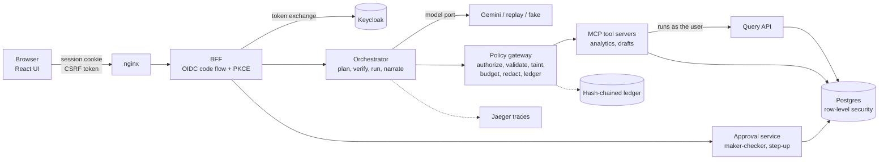

# Analytics Copilot

An enterprise treasury assistant. Users ask questions in a chat; the copilot answers from governed data, shows how it got each answer, and drafts work for a human to approve. It reads and drafts. It never executes.

This repository is a vertical slice of the full specification: every layer is real and runs end to end on a laptop. The language model sits behind a replaceable adapter.

## Run it

Requires Docker, [uv](https://docs.astral.sh/uv/) and Node 24 (only for the tests).

```bash
make demo        # builds and starts everything; real model calls if a key is configured
make up          # same stack; with no key, asking is refused instead of answered by a stand-in
make down
```

Open <http://localhost:3000>. First run generates random secrets into `deploy/compose/.env` (git-ignored).

**Model.** Put one key in `deploy/compose/.env`: `GROQ_API_KEY` (the default model is the cheapest on Groq, `openai/gpt-oss-20b`) or `GEMINI_API_KEY`. With both set, Groq is used because it is cheaper; set `MODEL_PROVIDER=gemini` to force the other. With no key, `make demo` answers with a canned model that plans one fixed query, so the rest of the product can still be tried. Free tiers have tight per-minute token limits: expect one question to take a few seconds, and wait a moment between questions.

| User | Role | Entities |
|---|---|---|
| `ana.analyst` | analyst | HAL-DE |
| `ben.analyst` | analyst | HAL-UK |
| `maria.manager` | treasury manager | HAL-DE, HAL-UK |
| `amit.approver` | approver | HAL-DE, HAL-UK |

The password is `DEMO_USER_PASSWORD` in `deploy/compose/.env`. Try the same question as `ana.analyst` and `ben.analyst`: *"How many booked transactions are there?"* Each sees only their own entity's rows, enforced by the database, not the app.

Traces for every run: <http://localhost:16686>. Identity provider: <http://localhost:8081>.

## How it works



**One request.** The user signs in at Keycloak. The BFF keeps the tokens server-side; the browser holds only an opaque cookie. A question goes to the orchestrator, which asks the model for a structured query plan. Code verifies the plan against the catalogue and renders parameterised SQL. The query runs through the Query API as that user, so Postgres row-level security decides which rows exist. Code, not the model, does the arithmetic and the date windows. If the model's numbers are not in the result, the answer falls back to a template. Every step is traced and every tool call is ledgered.

## Design rules that the code enforces

1. **Read and draft, never execute.** The highest tool tier is `DRAFT`. Approval is a separate service.
2. **Deterministic gates are final.** SQL verification, tool policy and money arithmetic run in code; a model can explain a block, never override it.
3. **The data layer owns authorization.** Queries run as the requesting user. Per-user Postgres roles and row-level security, with entitlements read from role membership.
4. **The model never computes.** Money is `Decimal` plus currency, dates are half-open windows resolved in code.
5. **Untrusted content is data.** It reaches a model only inside `<untrusted>` blocks; the gateway strips hidden characters and redacts IBANs.
6. **Fail closed.** Gateway, auth or guardrail down: refuse.
7. **Maker-checker in the database.** A constraint and a trigger stop a user approving a draft they made, even with a forged role claim.
8. **Everything is traced and versioned.** One trace id per run; prompts, models, catalogue and policy carry versions. Long attribute values are hashed, not stored.

Identity uses one token audience per hop (RFC 8693 token exchange), so a token minted for one service is useless at another.

## What is real and what is not

| Real | Stand-in |
|---|---|
| OIDC login with PKCE, server-side sessions, CSRF | The model is a real one when a key is set; with no key the demo uses a canned model that plans one fixed, still-verified query |
| Token exchange per hop | The warehouse is a synthetic company, *Halcyon Group* (seeded, deterministic) |
| Row-level security, per-user roles | Step-up authentication is enforced from token claims; Keycloak is not yet configured to run a second factor |
| SQL verifier, policy gateway, ledger, maker-checker | Cloud deployment (AWS and Azure) is specified, not built |
| Tracing end to end, read back in the UI | The eval baseline and a live Gemini run need an API key and have not been recorded |

## Quality gates

```bash
make lint          # ruff
make typecheck     # mypy --strict per project, plus the UI
make test          # unit tests, Python and UI
make test-integration   # against the running database and identity provider
make eval          # eval gates; proves they pass a ceiling and fail a floor
make e2e           # real browser (Playwright) against the real stack
```

The eval gold set is pinned to a world version and seed, scored against an independent oracle with bootstrap confidence intervals. See `Analytics Copilot.md` §6.

## Repository layout

```
apps/web/             React UI and browser tests
services/             bff, orchestrator, policy-gateway, query-api, approval
mcp-servers/          analytics and drafts tool servers
packages/             auth, models (ports and adapters), catalogue, sql-verifier,
                      tracing, drafts, schemas, evals, mcp-common, devtools
data/                 synthetic world generator, eval sets, semantic catalogue
deploy/               compose stack, container images, Keycloak realm
docs/adr/             decision records
Analytics Copilot.md  product specification
ARCHITECTURE.md       architecture, security model, deployment
```
